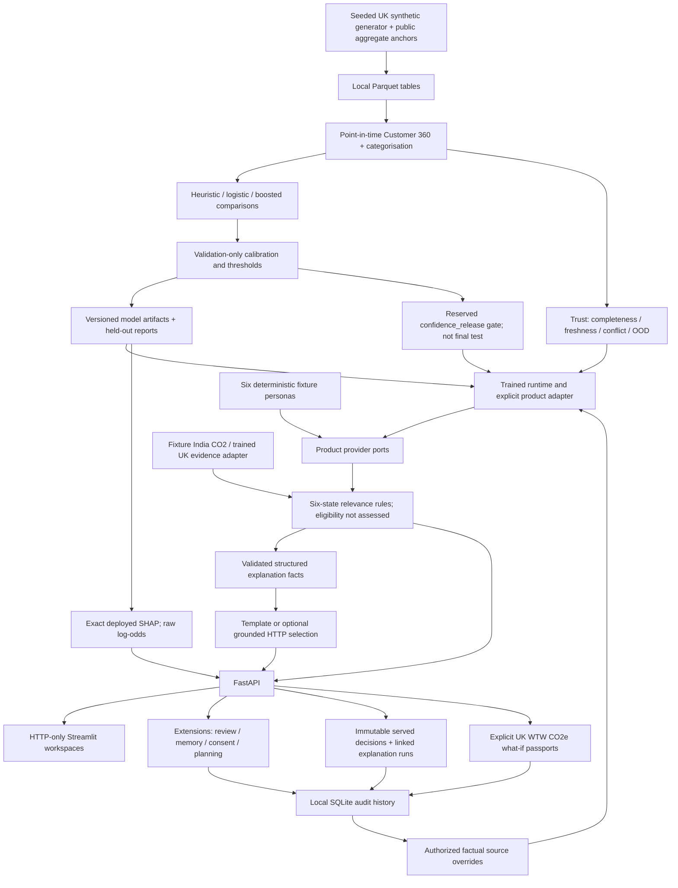

# Architecture

Modular monolith with a local HTTP presentation boundary; no microservice or autonomous financial decision claim.

Canonical scoring schemas are in `contracts/`; `contracts/product.py` is the validated product/API adapter view, not a replacement numeric feature schema. `ports.py` separates scoring, Trust, product snapshot/propensity, impact input and historical providers. `demo/artifacts.py` retains source evidence and confidence suppression.

Carbon geography is explicit: legacy India calculations and UK annual scenarios have different factors, boundaries and units. UK scenarios do not feed propensity. The trained UK adapter requires explicit physical assumptions and retains cutoff evidence; complete scenarios expose AVAILABLE CO2e in the product API with unit-matched emissions fields, while missing inputs return UNAVAILABLE. Legacy CO2 fields remain supported but cannot be mixed with CO2e. UI and grounded explanation schemas preserve units. Paperless has no carbon claim; only scoring/scenario passports support secondary avoided activity.

Explanations receive approved structured claims and sentence IDs, not raw merchant text or model features. They cannot calculate impact, change scores or assess eligibility. Feedback/reviewer actions change outreach/lifecycle only. Stored campaign contacts are simulated; no messages are sent.

`pipelines/run.py` reserves one third of the initial validation customers as `confidence_release` before propensity selection/calibration and confidence fitting. The reserved cohort gates display; test/stress diagnostics do not choose release. Current inspected core confidence is suppressed for all products. Trust threshold selection is a separate validation/scenario process in `trust/selection.py`.

`extensions/store.py` persists evidence-stable decisions and linked explanation runs. Token-authorized source updates use `contracts/lifecycle.py` and the trained source-override adapter, with event <= availability <= cutoff <= now. They rescore source facts, not feedback or what-if assumptions; prior decisions and monthly histories remain immutable. A verified Paperless source completion can close the local journey. This is not real bank writeback or production IAM.

Portfolio analytics retain missing evidence and outcome denominators. Physical totals group compatible product/units/boundary/period/method/factor versions; current evidence never fills missing historical impact or quality. Capacity is persisted across active simulated campaigns until closure.

The selected live manifest pins OpenAI `gpt-4.1-mini-2025-04-14`; `llm/live_evaluation.py` requires explicit paid authorization and is outside `make all`. No paid live run is claimed. Reviewed DESNZ 2025 factors remain frozen despite 2026 availability. PVGIS 5.3 support requires reviewed response bytes/hash and explicit installation inputs, not a generic yield default. See `EVALUATION_REPORT.md` for evidence boundaries.
