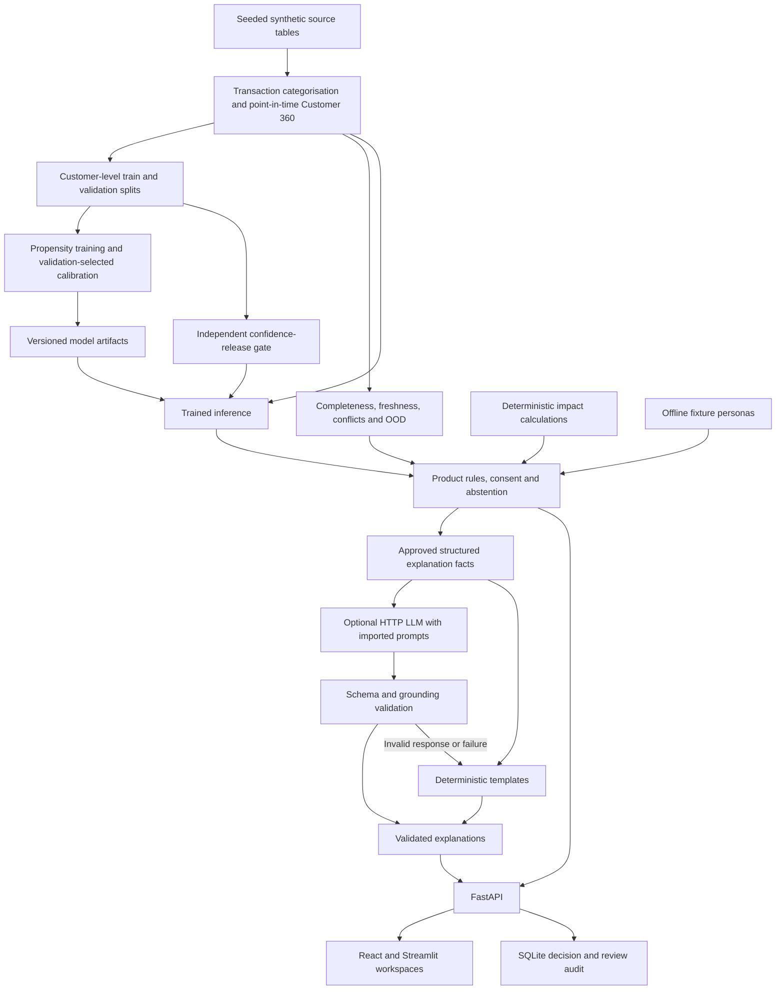

# Greenr Intelligence

Synthetic sustainability opportunity demo integrating Agent A's data, calibrated ML and reliability pipeline with Agent B's product rules, deterministic impact, grounded explanations, FastAPI and Streamlit. Relevance is not credit eligibility, approval or investment suitability.

## Trained models and inference code

The main [model folder](src/greenr/models/) contains product propensity models and transaction categorisation. The [propensity implementation](src/greenr/models/propensity/) includes training, calibration, artifact loading, inference and SHAP evidence. The [inference pipeline](src/greenr/pipelines/predict.py) applies trained models to point-in-time customer features.

Models compare heuristic, logistic regression and gradient-boosted candidates. Validation evidence selects the deployed model, calibration method and operating threshold; final-test labels do not select deployment.

## Preprocessing pipeline

The [preprocessing entry point](scripts/preprocess_data.py) loads raw Parquet tables, categorises transactions, builds point-in-time Customer 360 features, creates labels and customer-level splits, checks leakage, and exports model-ready inputs. The main [pipeline folder](src/greenr/pipelines/) contains the feature registry, snapshot builder, split policy and orchestration.

## Database schemas

- [Source-table schemas](src/greenr/pipelines/schemas.py): columns, logical types, primary keys, nullable fields and validation rules for the synthetic data tables.
- [SQLite audit schema](src/greenr/extensions/store.py): database table definitions for events, decisions and explanations.

## LLM implementation: prompts, model or API details, evaluation approach

- [Prompts folder](src/greenr/llm/prompts/): system prompts for grounded explanations and promotional copy, imported by the HTTP provider.
- [jagruti-1.5b model](https://huggingface.co/qwertzg/jagruti-1.5b): the model selected in the project's Responsible AI note. This reference does not establish that the current HTTP adapter serves this model.
- [HTTP provider](src/greenr/llm/http_provider.py) and [provider manifest](src/greenr/llm/provider_manifest.json): the optional adapter uses a chat-completions-shaped API with strict JSON-schema responses. The current manifest configures OpenAI's endpoint and the `gpt-6-luna` alias, marked as not live evaluated. Environment variables can override the endpoint and model; a compatible hosted endpoint is required to serve jagruti through this adapter.
- [LLM evaluation approach](LLM_EVAL.md): offline adversarial cases check approved claims, required sentences, exact numbers and units, schema validity, failures and template fallback. [Promo evaluation](src/greenr/llm/promo_evaluation.py) checks copy constraints separately. Offline results do not establish live model quality, latency or cost.

Without an API key, explanations use deterministic templates. The LLM cannot change model scores, calculate impact or decide financial eligibility; invalid grounded responses fall back to approved templates.

## Architecture diagram



See [architecture details](ARCHITECTURE.md) for contracts, provider boundaries and evidence provenance.

## Evaluation report

See the [evaluation report](EVALUATION_REPORT.md) for evaluation design, metric definitions, model comparisons, explanation grounding, system performance and limitations. The [detailed model evaluation](EVALUATION_REPORT_AGENT_A.md) provides per-product evidence, and the [machine-readable ML report](reports/ml_evaluation.json) records `validation_metrics` for model selection.

Validation metrics and held-out test metrics are distinct: calibration and thresholds are selected on validation data, confidence display is gated on an independent confidence-release cohort, and final-test results are reporting-only. The consolidated report flags inconsistent checked-in cohorts; these synthetic results are not certification of the current worktree or real-world performance.

## Responsible AI note: privacy, bias, explainability, hallucination, human oversight, data limitations

The [Responsible AI note](RESPONSIBLE_AI.md) documents synthetic-data privacy safeguards, bias checks, SHAP explainability, hallucination controls, reviewer oversight and data limitations. Recommendations indicate sustainability relevance, not credit eligibility or approval; impact estimates depend on explicit assumptions and are not guaranteed outcomes.

## Run

Requires Python 3.12 and `uv`; default explanations need no credentials.

Make targets add `src` to `PYTHONPATH`. If a direct `uv run` command reports `No module named 'greenr'` (for example, when macOS marks the editable installation's `.pth` file hidden), run it with an explicit source path:

```bash
PYTHONPATH="$PWD/src${PYTHONPATH:+:$PYTHONPATH}" uv run --locked python -m greenr.pipelines.run all --customers 4000
```

```bash
make all
make app
```

`make all` runs, in order, `setup`, `pipeline`, `test`, `evaluate-llm`, `scenarios`, and `evaluate-system`. The pipeline generates base and perturbed data, builds point-in-time Customer 360, trains/calibrates/evaluates models and writes predictions and manifests. The test command sets fixture mode; integration tests also train fresh temporary models and explicitly exercise trained mode. Default dataset size is 4,000 generated customers plus base personas; override with `make all CUSTOMERS=4000`. The main owner is running final integration gates; this documentation pass does not certify their outcome or counts. Earlier verification is historical, not evidence for the changed implementation. See `IMPLEMENTATION_PLAN.md`.

Open http://127.0.0.1:8501; API docs: http://127.0.0.1:8000/docs. The launcher stops its owned API/UI processes on termination. Alternate ports: `uv run --locked python -m greenr.demo.run --api-port 8001 --ui-port 8502`. Separate API: `make api`; separate UI: `uv run --locked streamlit run src/greenr/app/main.py`. `GREENR_API_URL` defaults to `http://127.0.0.1:8000`.

## Partner exploration demo

The Customer workspace's **Explore EV**, **Explore solar** and **Explore green home** journeys show two illustrative partner-product concepts each. The Customer Green Hub preview (`/customers/{id}/hub`) opens the same catalogue from its corresponding product buttons. They are placeholders, not real Lloyds offers, confirmed partnerships, quotes or credit approvals. The same read-only `/partners/catalogue` API supplies Streamlit and React. Browsing or previewing a handoff does not submit an application, send a lead, share customer details or change consent.

Lloyds can curate the exact products to promote by editing `src/greenr/partners/catalogue.json`, or by setting `GREENR_PARTNER_CATALOGUE` to an operator-managed JSON file. Set an option's `promoted` flag to `false` to hide it; add or replace options within a category to choose the shortlist. For a future live offer, replace the demo copy, set `placeholder` to `false`, and supply an approved HTTPS destination and source with accurate relationship, suitability and disclosure text. Placeholder entries cannot contain live links. Catalogue edits are validated on each API request; a bad catalogue disables only partner exploration, not customer evidence.

The **proposed** commercial model is a separately agreed completion-based referral fee and, where appropriate, finance or leasing income. No commission contract, revenue rate or realised revenue is claimed, and the demo has no referral-tracking integration. A live launch would also need approved offers, commercial agreements, compliance review and a consent-aware handoff.

